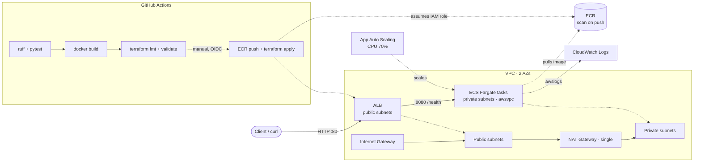

# FastAPI on AWS ECS Fargate

[](https://github.com/Fuego-Montana/aws-ecs-fargate-app/actions/workflows/ci.yml)


A production-style **containerised Python web service** running on **Amazon ECS Fargate** behind an
**Application Load Balancer**, with images in **ECR**, logs in **CloudWatch**, and **Application Auto
Scaling** – fully provisioned with **modular Terraform** and validated by **GitHub Actions** CI.
Built by Sule Anthony ([@Fuego-Montana](https://github.com/Fuego-Montana)) as a cloud engineering
portfolio project.

## Architecture



## API

| Method | Path     | Description                                      | Success |
|--------|----------|--------------------------------------------------|---------|
| GET    | `/health`| Health check (ALB / ECS)                         | 200     |
| GET    | `/`      | Welcome JSON (`service`, `version`, `environment`)| 200    |
| GET    | `/info`  | Runtime metadata (hostname, region, env)         | 200     |

```bash
ALB=$(terraform -chdir=terraform output -raw alb_dns_name)
curl -s "http://$ALB/health"
curl -s "http://$ALB/"
curl -s "http://$ALB/info"
```

## Project structure

```
.
├── src/fargate_app/          # FastAPI app (health, welcome, info)
├── tests/                    # pytest + TestClient (offline, no AWS)
├── Dockerfile                # multi-stage, non-root, Python 3.12-slim, :8080
├── terraform/
│   ├── main.tf / variables.tf / outputs.tf / versions.tf
│   └── modules/
│       ├── vpc/              # VPC, 2 public + 2 private subnets, IGW, single NAT
│       ├── ecr/              # repository, scan-on-push, lifecycle policy
│       ├── iam/              # task execution + task roles (least privilege)
│       ├── alb/              # ALB, HTTP listener, IP-mode TG, /health check
│       ├── ecs/              # cluster, Fargate service, task def, log group, SG
│       └── autoscaling/      # CPU target tracking (min/max tasks)
└── .github/workflows/ci.yml  # lint, test, docker build, tf validate, OIDC deploy
```

## Local development

Prerequisites: Python 3.12+, Terraform ≥ 1.6. Docker is optional locally (CI builds the image).

```bash
python -m venv .venv && source .venv/bin/activate
pip install -r requirements-dev.txt
ruff check . && ruff format --check .
pytest -v --cov=fargate_app

# Optional: run the app without Docker
uvicorn fargate_app.main:app --app-dir src --reload --port 8080

# Optional: build the image if Docker is installed
docker build -t fargate-app:local .
docker run --rm -p 8080:8080 fargate-app:local
```

Tests use FastAPI's `TestClient` and run fully offline with no AWS account.

## Deploy

Region defaults to **`ap-southeast-2`** (Sydney – closest commercial region for Perth/WA).

```bash
cd terraform
cp terraform.tfvars.example terraform.tfvars   # optional: adjust region/env
terraform init
terraform plan -out=tfplan
terraform apply tfplan

# First apply creates ECR (among other resources). Build & push your image:
AWS_ACCOUNT=$(aws sts get-caller-identity --query Account --output text)
REGION=$(terraform output -raw 2>/dev/null; echo ap-southeast-2)
ECR=$(terraform output -raw ecr_repository_url)
aws ecr get-login-password --region ap-southeast-2 \
  | docker login --username AWS --password-stdin "$ECR"
docker build -t "$ECR:latest" ..
docker push "$ECR:latest"

# Point the service at your image and apply again:
terraform apply -var="container_image=$ECR:latest"
terraform output alb_url
```

> **Note:** If `container_image` is left empty, Terraform uses a public placeholder image so the
> stack can still plan/apply. Replace it with your ECR URI after the first push for a real deploy.

## Destroy

```bash
cd terraform
terraform destroy
```

NAT Gateway and ALB incur hourly charges – destroy when finished. All resources are tagged
`Project`, `Environment`, `ManagedBy=terraform`, `Owner=Fuego-Montana`.

## CI/CD (GitHub Actions)

On every push / PR, `.github/workflows/ci.yml` runs:

1. **Python** – `ruff check`, `ruff format --check`, `pytest` with coverage.
2. **Docker** – multi-stage image build (no push) to prove the Dockerfile works.
3. **Terraform** – `terraform fmt -check -recursive`, `init -backend=false`, `validate`.

**Optional deploy job** (manual `workflow_dispatch` with `deploy: true`) authenticates to AWS using
**GitHub OIDC** – no long-lived access keys. It logs into ECR, builds/pushes the image, then runs
`terraform plan/apply` with the new image URI. To enable it:

1. Create an IAM OIDC identity provider for `token.actions.githubusercontent.com` (audience `sts.amazonaws.com`).
2. Create an IAM role trusted by that provider, restricted to this repo, e.g. condition
   `token.actions.githubusercontent.com:sub` = `repo:Fuego-Montana/aws-ecs-fargate-app:environment:dev`.
3. Grant the role permissions for ECR, ECS, EC2/VPC, ELB, IAM (roles used here), CloudWatch Logs,
   and Application Auto Scaling.
4. Add repository secret `AWS_ROLE_ARN` and optionally variable `AWS_REGION` (`ap-southeast-2`),
   plus a `dev` environment.
5. Configure the S3 backend in `terraform/versions.tf` so state persists between runs.

The deploy job is entirely optional; CI passes without any AWS secrets.

## Security & design decisions

- **Private tasks**: Fargate tasks run in private subnets with `assign_public_ip = false`; outbound
  via a single NAT Gateway. Only the ALB is internet-facing.
- **Security groups**: ALB allows `:80` from `0.0.0.0/0`; ECS SG allows `:8080` **only** from the ALB SG.
- **Least-privilege IAM**: separate execution role (ECR pull + logs) and task role (minimal app policy);
  no `FullAccess` managed policies on the task role.
- **Non-root container**: Dockerfile creates `appuser` and drops privileges; multi-stage build keeps
  the runtime image slim.
- **ECR scanning**: `scan_on_push = true` plus a lifecycle policy that retains the last N tagged images.
- **OIDC deploy**: GitHub Actions assumes an IAM role via OIDC – no static AWS keys in secrets.
- **Health checks**: ALB target group and optional container health check both hit `GET /health`.

## Cost notes

This stack is sized for demos but is **not free-tier zero-cost** (NAT Gateway + ALB dominate):

| Resource              | Approx. cost driver                          | Demo tip                                      |
|-----------------------|----------------------------------------------|-----------------------------------------------|
| NAT Gateway           | ~$0.045/hr + data                            | Single NAT (not one per AZ); destroy when idle|
| Application LB        | ~$0.0225/hr + LCU                            | One ALB; destroy when idle                    |
| Fargate (256/512)     | vCPU + memory seconds                        | `desired_count = 1`; consider Fargate Spot*   |
| ECR / CloudWatch Logs | storage + ingestion                          | Lifecycle policy; 14-day log retention        |

\*Fargate Spot is commented in the ECS module for optional non-prod savings.

Run `terraform destroy` when finished to avoid ongoing charges.

## Possible improvements

- HTTPS listener with ACM certificate and HTTP→HTTPS redirect
- Fargate Spot capacity provider strategy for non-prod
- AWS X-Ray / Container Insights and CloudWatch alarms
- Blue/green or canary deploys via CodeDeploy / ECS deployment circuit breaker
- Remote state in S3 with DynamoDB locking; multiple environments via workspaces
- Secrets Manager / SSM Parameter Store for runtime config

## Skills demonstrated

- **AWS containers**: ECS Fargate, ECR, ALB (IP target mode), VPC (public/private), NAT, CloudWatch Logs, Application Auto Scaling, IAM
- **Infrastructure as Code**: modular Terraform (6 modules), input validation, outputs, default tagging
- **Security**: private subnets, SG least privilege, non-root container, OIDC federation for CI (no static keys), ECR image scanning
- **Python**: FastAPI, clean endpoints, structured JSON responses
- **Testing**: pytest with FastAPI TestClient, coverage, offline CI
- **CI/CD**: GitHub Actions with lint, test, Docker build, IaC validation, and gated OIDC deploy (ECR push + apply)

## License

[MIT](LICENSE) © 2026 Sule Anthony
